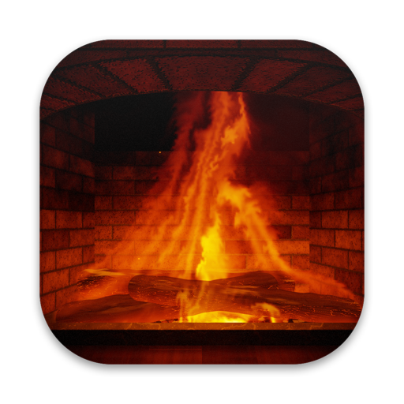
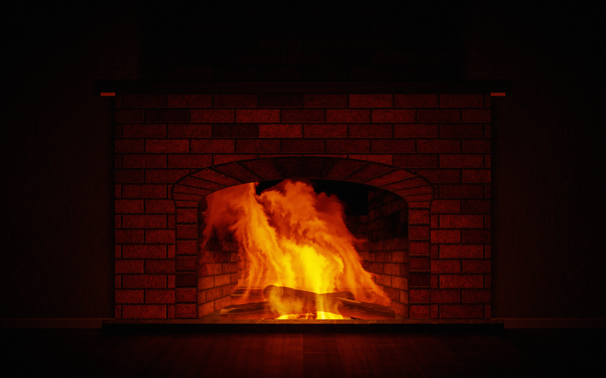

# Fireplace



A menu bar app for macOS that listens to the microphone for a double clap.



- **First double clap:** your desktop becomes a fireplace with a live, physically simulated fire, and every other app quits.
- **Second double clap:** the fire fades out, your original wallpaper comes back, and Fireplace quits.

## Build and run

```bash
./build.sh
open build/Fireplace.app
```

On first launch macOS asks for microphone access. While the app runs, a flame icon sits in the menu bar. Its menu shows the status and lets you light the fire or quit without clapping.

Launch it with `open` (or from Finder), not by running the binary inside a terminal. The terminal gets quit along with the other apps, and that would take Fireplace down with it.

## The fire

The flames aren't an animation. They're a 2D fluid simulation that runs on the GPU in Metal compute shaders, 60 steps a second:

- **Flow:** incompressible air with semi-Lagrangian advection, a Jacobi pressure solve, Boussinesq buoyancy (hot gas rises) and vorticity confinement (keeps the swirls). Room air comes in through the mouth of the fireplace and leaves up the chimney throat.
- **Combustion:** hot logs give off fuel gas in wandering hot spots. Above its ignition temperature the gas burns, releasing heat and soot. Everything cools by mixing and by T⁴ radiation.
- **Light:** only hot soot glows, as a black body: its color and Stefan–Boltzmann brightness come from its temperature. The room is lit by the fire's total heat, so the bricks brighten and dim with the flames. Sparks are particles carried by the airflow.

The rest of the scene is drawn once per screen size: bump-mapped brick, charred logs with glowing cracks, the coal bed, the mantel, the floor.

**Every fire is different.** Each time the fire is lit, the app takes a 64-bit seed from `SecRandomCopyBytes`. That's the kernel's random generator, which macOS seeds from the hardware true random number generator (the Secure Enclave on Apple silicon). The seed places the logs, colors the bricks and drives the fuel release. Fluid flow is chaotic, so no two fires ever burn the same way, on your Mac or anyone else's.

## How it stays idle

Until the fire is lit, nothing polls. Core Audio delivers microphone buffers to a tap callback, and a small state machine looks at each 5 ms slice of sound. It flags a clap only when the sound jumps sharply, peaks within about 12 ms, and dies away within 100 ms, with quiet between the two claps. The main thread wakes up only when a double clap is detected.

Once lit, the simulation draws at 30 fps and costs about 1.2 ms of GPU time per frame on an M3 Pro. It pauses whenever app windows fully cover the desktop.

## Tuning

```bash
defaults write com.fima.Fireplace ClapThreshold -float 0.03   # raise if it triggers too easily (default 0.015)
defaults write com.fima.Fireplace MaxClapGap -float 1.0       # allow slower double claps (default 0.8 s)
defaults write com.fima.Fireplace KeepRunning -array com.apple.Music com.spotify.client   # apps not to quit
```

Developer commands:

```bash
build/Fireplace.app/Contents/MacOS/Fireplace --preview            # live fire in a normal window; quits nothing
build/Fireplace.app/Contents/MacOS/Fireplace --analyze clip.wav   # list the claps found in a recording
build/Fireplace.app/Contents/MacOS/Fireplace --render out.png     # a still of a fresh fire (--seconds N to let it burn longer)
build/Fireplace.app/Contents/MacOS/Fireplace --make-icon AppIcon.iconset   # render a new app icon
```
